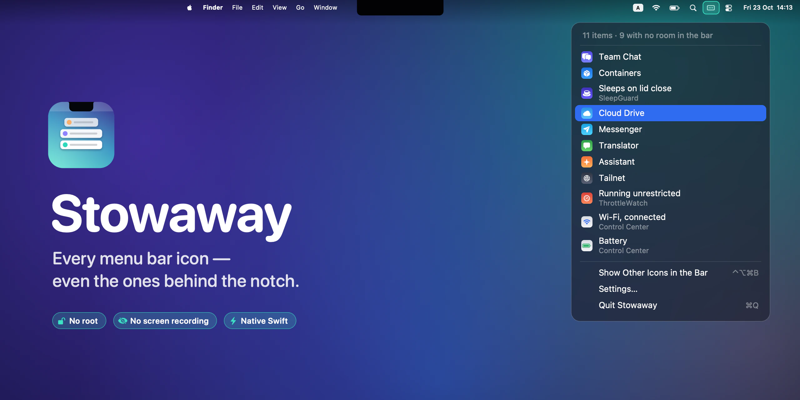
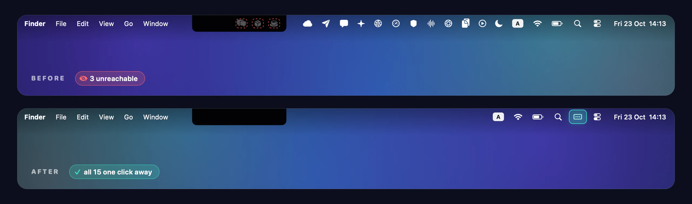
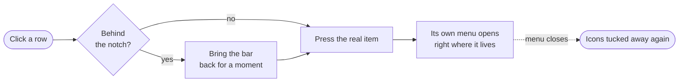

<p align="center">
  
</p>

<h1 align="center">Stowaway</h1>

<p align="center">
  <strong>Every menu bar icon — even the ones behind the notch.</strong><br>
  A tiny native macOS app that tucks menu bar clutter out of sight<br>
  and hands every item back as a vertical list, one click away.
</p>

<p align="center">
  <a href="https://github.com/an6122003/stowaway/releases/latest"></a>
  
  
  
  
  <a href="LICENSE"></a>
</p>

<p align="center">
  <strong>English</strong> ·
  <a href="README.vi.md">Tiếng Việt</a> ·
  <a href="README.zh-CN.md">简体中文</a>
</p>



## The problem nobody warns you about

On a MacBook with a notch, the menu bar has a hard wall in the middle of it. Install one menu bar app too many and macOS doesn't shrink anything, doesn't wrap, doesn't offer an overflow menu — it simply stops drawing the icons that don't fit. The apps are still running. You just can't click them anymore.



Stowaway fixes that in two moves:

- **It tidies the bar.** Third-party icons are tucked behind the notch, while Wi‑Fi, battery, Spotlight and the clock stay exactly where they always were.
- **It gives everything back.** One click — or <kbd>⌃</kbd> <kbd>⌥</kbd> <kbd>⌘</kbd> <kbd>B</kbd> from anywhere — drops a vertical list of every menu bar item, hidden ones included. Pick one and its real menu opens.

## Features

| | |
|---|---|
| 🗂 **A list of everything** | Every menu bar item, labelled and shown with its app's icon. The header tells you how many have no room in the bar. |
| 🎯 **Opens the real menu** | Choosing a hidden item brings the bar back for a moment so its menu has somewhere to appear, then tucks it away again the instant you close it. |
| 🍏 **Apple's indicators stay put** | Wi‑Fi, battery, Spotlight, input source and the clock never move. Only third-party icons are stowed. |
| ⌨️ **Global shortcut** | <kbd>⌃⌥⌘B</kbd> opens the list from any app. The shortcut itself needs no permission at all. |
| 🪶 **One icon of overhead** | Stowaway pins a single icon to the right edge. Hide even that, and opening Stowaway again from Spotlight still brings up the list. |
| 🔒 **Nothing scary** | No root, no screen recording, no kernel extension, no network access. Pure Swift and AppKit, zero dependencies. |

## A closer look at the list

<p align="center">
  
</p>

Items are labelled the way the system describes them, so Control Center's modules show up as *Wi‑Fi*, *Battery* and *Focus* rather than a wall of identical "Control Center" rows. Modules macOS has switched off — still published, but zero points wide — are filtered out.

## How it works

macOS has no API for moving, hiding or taking over another app's menu bar item. Stowaway doesn't need one. It uses the only lever macOS gives every app — **the width of its own status item** — plus three measurements.


1. **The overflow.** macOS packs menu bar items from the right edge leftward. When they run out of room, the leftmost slide behind the notch and are simply not drawn.
2. **The pin.** Stowaway places an invisible spacer between your third-party icons and Apple's indicators. Status item placement can be steered through an undocumented preference — `NSStatusItem Preferred Position`, where *lower sits further right* — and the exact slot is found by measuring where the spacer lands and correcting.
3. **The push.** Widening the spacer shifts everything to its left by the same amount. Push just far enough and every third-party icon ends up behind the notch, while Apple's indicators, to the spacer's right, don't move a pixel.

<details>
<summary><b>The details that took longest to get right</b></summary>
<br>

- **Where the menu bar actually begins.** It's tempting to infer the left edge of the usable bar from the leftmost visible icon. That's wrong: on the MacBook this was built on, icons are *reported* at x = 860 while the bar only becomes drawable at x = 948 — which is precisely why those icons are unreachable. `NSScreen.auxiliaryTopRightArea` reports the region beside the notch directly, so Stowaway asks instead of guessing.
- **Pushing precisely.** The shift macOS applies runs a little wider than the length requested, so the push calibrates itself: Stowaway measures where the icons landed and widens the push until no third-party icon is left on screen. Because Apple's indicators sit to the spacer's right, over-pushing can't cost them anything — a one-directional search rather than a balancing act.
- **Never swallowing clicks.** While expanded, the spacer's window is wider than the screen and physically overlaps your app menus. It ignores mouse events, so clicks pass straight through.
- **Listing and pressing.** The list comes from the Accessibility API — each app's `AXExtrasMenuBar` children, scanned in parallel with a 0.15 s timeout per request. Apps known to own items are remembered, so steady-state refreshes touch a handful of processes rather than every one running.
- **Hiding again.** After you open a hidden item, Stowaway watches its `AXSelected` state and tucks the bar away the moment the menu closes.

</details>



## Install

1. Download **Stowaway-1.0.dmg** from [Releases](https://github.com/an6122003/stowaway/releases/latest).
2. Open it and drag **Stowaway** into **Applications**.
3. Launch it. Stowaway isn't notarized yet, so macOS blocks the first launch: open **System Settings → Privacy & Security** and click **Open Anyway** — or run:
   ```bash
   xattr -dr com.apple.quarantine /Applications/Stowaway.app
   ```
4. Click Stowaway's icon, choose **Allow Stowaway to list your menu bar items…**, then enable Stowaway under **Privacy & Security → Accessibility**.

> **Requirements:** macOS 13 Ventura or later. Universal binary for Apple Silicon and Intel. Designed for notched MacBooks; works on any Mac.

## Using it

| To… | Do this |
|---|---|
| See every menu bar item | Click Stowaway's icon, or press <kbd>⌃⌥⌘B</kbd> |
| Open an app whose icon is hidden | Pick it from the list |
| Bring every icon back into the bar | **Show Other Icons in the Bar**, at the bottom of the list |
| Change how it behaves | Right-click Stowaway's icon → **Settings** |
| Reach Stowaway with its icon hidden | Open Stowaway again from Spotlight |

**Settings**

- **Keep Wi‑Fi, Battery and Clock Visible** — on by default. Turn it off to tuck *everything* away.
- **Hide Other Icons** — switch the tidying off and use Stowaway purely as a list.
- **Show Stowaway's Own Icon** — go fully keyboard-driven.
- **Open at Login**

## Privacy

Stowaway asks for one permission, **Accessibility**, and uses it for exactly two things: reading the menu bar items — their names, owners and positions — and pressing the one you choose. It doesn't read windows, keystrokes or screen contents; the global shortcut uses Carbon's `RegisterEventHotKey`, which needs no permission at all. There is no networking code in the app.

## FAQ

<details>
<summary><b>Stowaway is ticked in Accessibility, but the list still asks for permission.</b></summary>
<br>

macOS ties the grant to the exact build of an app. After updating to a differently signed build, the old tick refers to an app that no longer exists — and because an entry exists, macOS doesn't ask again. Clear it, then grant once more:

```bash
tccutil reset Accessibility io.github.an6122003.stowaway
```
</details>

<details>
<summary><b>There's empty space between the notch and my icons.</b></summary>
<br>

That's the bar packing from the right, as it always does — it's what a menu bar with fewer icons looks like. Stowaway puts the gap where the hidden icons used to be, rather than opening a hole in the middle of your indicators.
</details>

<details>
<summary><b>Now Playing and Focus get tucked away too.</b></summary>
<br>

Control Center shuffles these transient modules leftward on its own when the bar re-flows, so they travel with the third-party icons. They're still one click away in the list. Wi‑Fi, battery, Spotlight, input source and the clock always stay.
</details>

<details>
<summary><b>I installed a new menu bar app and it's still showing.</b></summary>
<br>

Stowaway measures your bar while everything is on show. Choose **Show Other Icons in the Bar** once, give it a moment to re-measure, then hide them again.
</details>

<details>
<summary><b>How is this different from Bartender or Ice?</b></summary>
<br>

Apps like Bartender and Ice can capture the menu bar with Screen Recording and redraw it in a window of their own, which lets them do more — reordering, a second bar — at the cost of a heavier permission and more moving parts. Stowaway only ever changes the width of its own status item and reads what Accessibility already exposes. Less power, far less to break.
</details>

## Build from source

```bash
git clone https://github.com/an6122003/stowaway.git
cd stowaway
./build.sh          # → build/Stowaway.app   (host architecture)
./package.sh        # → dist/Stowaway-1.0.dmg (universal)
```

No Xcode project and no dependencies — just the Xcode Command Line Tools.

> **Rebuilding often?** An ad-hoc signature changes with every build, which silently invalidates the Accessibility grant. `build.sh` signs with an Apple Development certificate if you have one; otherwise create a stable local identity once with `./scripts/make-signing-identity.sh`. Release builds use `STOWAWAY_SIGN=adhoc ./package.sh`, so no certificate details end up in the binary.

Handy while hacking:

```bash
./scripts/make-readme-art.sh     # regenerate every image in this README
defaults write io.github.an6122003.stowaway DebugDiagnostics -bool true
                                 # write the measured bar layout to $TMPDIR/stowaway-layout.txt
```

| Path | |
|---|---|
| `Sources/AppDelegate.swift` | Status items, the width lever, calibration, menus |
| `Sources/MenuBarItems.swift` | Accessibility: listing and pressing other apps' items |
| `Sources/GlobalHotKey.swift` | The permission-free global shortcut |
| `scripts/make-icon.swift` | The app icon, drawn in code |
| `scripts/make-readme-art.swift` | Every image in this README, drawn in code |

## Prior art

The expanding-spacer technique comes from [Dozer](https://github.com/Mortennn/Dozer) and [Hidden Bar](https://github.com/dwarvesf/hidden) by Dwarves Foundation. Stowaway adds the vertical list, notch-aware precise pushing that leaves Apple's indicators in place, and re-hiding the moment a menu closes.

## License

[MIT](LICENSE) © 2026 an6122003
