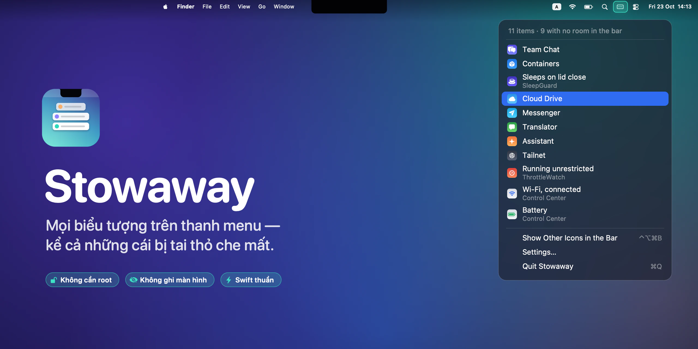
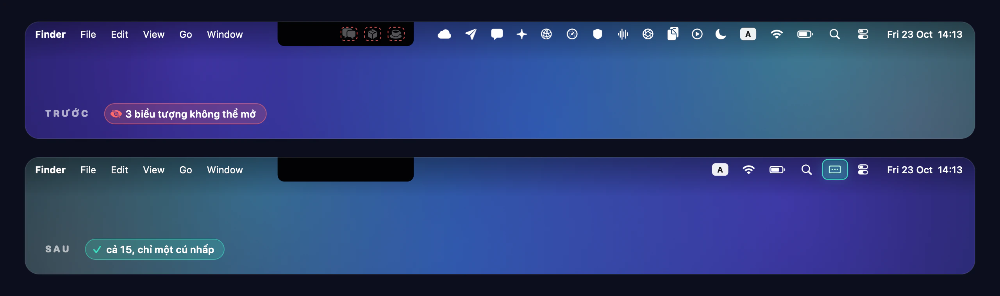
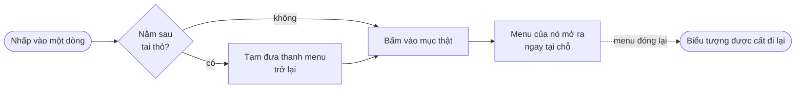

<p align="center">
  
</p>

<h1 align="center">Stowaway</h1>

<p align="center">
  <strong>Mọi biểu tượng trên thanh menu — kể cả những cái bị tai thỏ che mất.</strong><br>
  Một ứng dụng macOS nhỏ gọn, viết thuần Swift, giúp dọn gọn thanh menu<br>
  và trả lại toàn bộ biểu tượng dưới dạng một danh sách dọc, chỉ cách một cú nhấp.
</p>

<p align="center">
  <a href="https://github.com/an6122003/stowaway/releases/latest"></a>
  
  
  
  
  <a href="LICENSE"></a>
</p>

<p align="center">
  <a href="README.md">English</a> ·
  <strong>Tiếng Việt</strong> ·
  <a href="README.zh-CN.md">简体中文</a>
</p>



## Vấn đề không ai nói trước với bạn

Trên MacBook có tai thỏ (notch), thanh menu có một bức tường cứng ngay chính giữa. Chỉ cần cài thêm một ứng dụng thanh menu là quá tải: macOS không thu nhỏ gì, không xuống dòng, cũng chẳng có menu "xem thêm" — nó chỉ đơn giản là thôi không vẽ những biểu tượng hết chỗ nữa. Ứng dụng vẫn chạy, nhưng bạn không còn cách nào bấm vào biểu tượng của nó.



Stowaway giải quyết chuyện này bằng hai bước:

- **Dọn gọn thanh menu.** Biểu tượng của các ứng dụng bên thứ ba được cất ra sau tai thỏ, còn Wi‑Fi, pin, Spotlight và đồng hồ vẫn nằm nguyên chỗ cũ.
- **Trả lại mọi thứ.** Một cú nhấp — hoặc nhấn <kbd>⌃</kbd> <kbd>⌥</kbd> <kbd>⌘</kbd> <kbd>B</kbd> ở bất cứ đâu — sẽ mở ra một danh sách dọc gồm mọi mục trên thanh menu, kể cả những mục đang bị ẩn. Chọn một mục, menu thật của nó sẽ hiện ra.

## Tính năng

| | |
|---|---|
| 🗂 **Danh sách đầy đủ** | Mọi mục trên thanh menu, có tên và biểu tượng của ứng dụng. Dòng tiêu đề cho biết có bao nhiêu mục không còn chỗ trên thanh menu. |
| 🎯 **Mở đúng menu thật** | Khi bạn chọn một mục đang bị ẩn, Stowaway tạm đưa thanh menu trở lại để menu có chỗ hiện ra, rồi cất đi ngay khi bạn đóng menu. |
| 🍏 **Biểu tượng của Apple giữ nguyên** | Wi‑Fi, pin, Spotlight, bộ gõ và đồng hồ không hề xê dịch. Chỉ biểu tượng của bên thứ ba bị cất đi. |
| ⌨️ **Phím tắt toàn hệ thống** | <kbd>⌃⌥⌘B</kbd> mở danh sách từ bất kỳ ứng dụng nào. Bản thân phím tắt không cần cấp quyền gì cả. |
| 🪶 **Chỉ tốn một biểu tượng** | Stowaway ghim đúng một biểu tượng ở mép phải. Ẩn luôn cả biểu tượng đó cũng được — mở lại Stowaway từ Spotlight vẫn sẽ hiện danh sách. |
| 🔒 **Không có gì đáng lo** | Không cần root, không ghi màn hình, không kernel extension, không kết nối mạng. Thuần Swift và AppKit, không phụ thuộc thư viện ngoài. |

## Cận cảnh danh sách

<p align="center">
  
</p>

Các mục được gắn nhãn đúng như cách hệ thống mô tả chúng, nên các mô-đun của Trung tâm điều khiển hiện ra với tên riêng như *Wi‑Fi*, *Pin* hay *Tập trung*, thay vì một loạt dòng "Control Center" giống hệt nhau. Những mô-đun đã bị macOS tắt — vẫn tồn tại nhưng có độ rộng bằng 0 — sẽ được lọc bỏ.

## Cách hoạt động

macOS không có API nào cho phép di chuyển, ẩn hay can thiệp vào mục thanh menu của ứng dụng khác. Stowaway không cần đến nó. Ứng dụng dùng chiếc đòn bẩy duy nhất mà macOS trao cho mọi ứng dụng — **độ rộng của chính status item của mình** — cùng ba phép đo.


1. **Tràn.** macOS xếp các mục thanh menu từ mép phải sang trái. Khi hết chỗ, những mục ngoài cùng bên trái trượt ra sau tai thỏ và đơn giản là không được vẽ.
2. **Ghim.** Stowaway đặt một vách ngăn vô hình giữa biểu tượng bên thứ ba và các biểu tượng của Apple. Vị trí của status item có thể điều khiển qua một thiết lập không được công bố — `NSStatusItem Preferred Position`, *giá trị càng nhỏ càng nằm về bên phải* — và vị trí chính xác được tìm ra bằng cách đo xem vách ngăn rơi vào đâu rồi hiệu chỉnh.
3. **Đẩy.** Nới rộng vách ngăn sẽ dịch mọi thứ bên trái nó sang trái một khoảng bằng nhau. Đẩy vừa đủ xa, mọi biểu tượng bên thứ ba sẽ nằm sau tai thỏ, còn biểu tượng của Apple — ở bên phải vách ngăn — không xê dịch dù chỉ một điểm ảnh.

<details>
<summary><b>Những chi tiết tốn công nhất</b></summary>
<br>

- **Thanh menu thực sự bắt đầu từ đâu.** Rất dễ suy ra mép trái của vùng dùng được từ biểu tượng ngoài cùng bên trái. Nhưng như thế là sai: trên chiếc MacBook dùng để phát triển, biểu tượng được *báo cáo* ở x = 860, trong khi thanh menu chỉ thực sự vẽ được từ x = 948 — đó chính là lý do những biểu tượng ấy không thể bấm vào. `NSScreen.auxiliaryTopRightArea` cho biết trực tiếp vùng bên cạnh tai thỏ, nên Stowaway hỏi thẳng hệ thống thay vì đoán.
- **Đẩy thật chính xác.** Độ dịch mà macOS thực sự áp dụng luôn rộng hơn một chút so với độ dài được yêu cầu, nên lực đẩy tự hiệu chỉnh: Stowaway đo vị trí các biểu tượng sau khi đẩy và nới dần cho đến khi không còn biểu tượng bên thứ ba nào trên màn hình. Vì biểu tượng của Apple nằm bên phải vách ngăn, đẩy quá tay cũng không ảnh hưởng gì đến chúng — một phép tìm kiếm một chiều, thay vì phải cân bằng hai phía.
- **Không bao giờ nuốt mất cú nhấp.** Khi nới rộng, cửa sổ của vách ngăn còn rộng hơn cả màn hình và đè lên các menu của ứng dụng. Nó được đặt để bỏ qua sự kiện chuột, nên cú nhấp đi xuyên thẳng xuống bên dưới.
- **Liệt kê và bấm.** Danh sách được lấy từ Accessibility API — các phần tử con `AXExtrasMenuBar` của từng ứng dụng, quét song song với thời gian chờ 0,15 giây cho mỗi yêu cầu. Ứng dụng nào đã biết là có mục trên thanh menu sẽ được ghi nhớ, nên các lần làm mới về sau chỉ cần chạm tới vài tiến trình thay vì tất cả.
- **Cất đi lại.** Sau khi bạn mở một mục đang bị ẩn, Stowaway theo dõi trạng thái `AXSelected` của nó và cất thanh menu đi ngay khi menu đóng lại.

</details>



## Cài đặt

1. Tải **Stowaway-1.0.dmg** từ mục [Releases](https://github.com/an6122003/stowaway/releases/latest).
2. Mở file và kéo **Stowaway** vào thư mục **Applications**.
3. Mở ứng dụng. Stowaway chưa được Apple công chứng (notarize), nên macOS sẽ chặn lần mở đầu tiên: vào **Cài đặt hệ thống → Quyền riêng tư & Bảo mật** rồi bấm **Vẫn mở** — hoặc chạy lệnh:
   ```bash
   xattr -dr com.apple.quarantine /Applications/Stowaway.app
   ```
4. Nhấp vào biểu tượng của Stowaway, chọn **Allow Stowaway to list your menu bar items…**, rồi bật Stowaway trong **Quyền riêng tư & Bảo mật → Trợ năng**.

> **Yêu cầu:** macOS 13 Ventura trở lên. Bản universal, chạy trên cả Apple Silicon lẫn Intel. Được thiết kế cho MacBook có tai thỏ, nhưng dùng được trên mọi máy Mac.

## Sử dụng

| Muốn… | Làm thế này |
|---|---|
| Xem mọi mục trên thanh menu | Nhấp vào biểu tượng Stowaway, hoặc nhấn <kbd>⌃⌥⌘B</kbd> |
| Mở một ứng dụng có biểu tượng đang bị ẩn | Chọn nó trong danh sách |
| Đưa mọi biểu tượng trở lại thanh menu | **Show Other Icons in the Bar** ở cuối danh sách |
| Thay đổi cách hoạt động | Nhấp chuột phải vào biểu tượng Stowaway → **Settings** |
| Mở Stowaway khi đã ẩn biểu tượng của nó | Mở lại Stowaway từ Spotlight |

**Thiết lập** *(giao diện ứng dụng hiện bằng tiếng Anh)*

- **Keep Wi‑Fi, Battery and Clock Visible** — bật sẵn. Tắt đi nếu muốn cất *mọi thứ*.
- **Hide Other Icons** — tắt hẳn việc dọn gọn, chỉ dùng Stowaway như một danh sách.
- **Show Stowaway's Own Icon** — chuyển sang dùng hoàn toàn bằng bàn phím.
- **Open at Login** — tự mở khi đăng nhập.

## Quyền riêng tư

Stowaway chỉ xin đúng một quyền là **Trợ năng (Accessibility)**, và dùng nó cho đúng hai việc: đọc các mục trên thanh menu — tên, ứng dụng sở hữu và vị trí của chúng — và bấm vào mục bạn chọn. Ứng dụng không đọc cửa sổ, phím gõ hay nội dung màn hình; phím tắt toàn hệ thống dùng `RegisterEventHotKey` của Carbon, vốn không cần quyền gì cả. Trong ứng dụng không có bất kỳ đoạn mã kết nối mạng nào.

## Câu hỏi thường gặp

<details>
<summary><b>Stowaway đã được bật trong Trợ năng nhưng danh sách vẫn đòi cấp quyền.</b></summary>
<br>

macOS gắn quyền với đúng bản build của ứng dụng. Sau khi cập nhật lên một bản được ký khác, dấu tích cũ trỏ tới một ứng dụng không còn tồn tại — và vì trong danh sách đã có mục đó, macOS sẽ không hỏi lại. Hãy xoá đi rồi cấp quyền lại một lần:

```bash
tccutil reset Accessibility io.github.an6122003.stowaway
```
</details>

<details>
<summary><b>Có một khoảng trống giữa tai thỏ và các biểu tượng của tôi.</b></summary>
<br>

Đó là thanh menu xếp từ phải sang như nó vẫn luôn làm — thanh menu ít biểu tượng hơn trông sẽ như vậy. Stowaway dời khoảng trống về chỗ các biểu tượng bị ẩn từng nằm, thay vì để lại một lỗ hổng ngay giữa các biểu tượng hệ thống.
</details>

<details>
<summary><b>Now Playing và Focus cũng bị cất đi.</b></summary>
<br>

Trung tâm điều khiển tự dời các mô-đun tạm thời này sang trái mỗi khi thanh menu sắp xếp lại, nên chúng bị cất đi cùng biểu tượng bên thứ ba. Chúng vẫn chỉ cách một cú nhấp trong danh sách. Wi‑Fi, pin, Spotlight, bộ gõ và đồng hồ thì luôn ở lại.
</details>

<details>
<summary><b>Tôi vừa cài thêm một ứng dụng thanh menu mà nó vẫn hiện.</b></summary>
<br>

Stowaway đo thanh menu khi mọi thứ đang hiển thị. Chọn **Show Other Icons in the Bar** một lần, đợi một chút để nó đo lại, rồi ẩn đi lần nữa.
</details>

<details>
<summary><b>Khác gì so với Bartender hay Ice?</b></summary>
<br>

Những ứng dụng như Bartender và Ice có thể chụp lại thanh menu bằng quyền Ghi màn hình rồi vẽ lại trong cửa sổ riêng, nhờ vậy làm được nhiều hơn — sắp xếp lại, thêm một thanh thứ hai — đổi lại là quyền nặng hơn và nhiều khâu dễ trục trặc hơn. Stowaway chỉ thay đổi độ rộng status item của chính nó và đọc những gì Trợ năng vốn đã cung cấp. Ít tính năng hơn, nhưng cũng ít thứ có thể hỏng hơn hẳn.
</details>

## Tự build từ mã nguồn

```bash
git clone https://github.com/an6122003/stowaway.git
cd stowaway
./build.sh          # → build/Stowaway.app   (kiến trúc của máy đang dùng)
./package.sh        # → dist/Stowaway-1.0.dmg (bản universal)
```

Không cần project Xcode, không phụ thuộc thư viện ngoài — chỉ cần Xcode Command Line Tools.

> **Build lại thường xuyên?** Chữ ký ad-hoc thay đổi sau mỗi lần build, khiến quyền Trợ năng âm thầm mất hiệu lực. `build.sh` sẽ ký bằng chứng chỉ Apple Development nếu bạn có; nếu không, hãy tạo một danh tính ký cục bộ cố định một lần bằng `./scripts/make-signing-identity.sh`. Bản phát hành dùng `STOWAWAY_SIGN=adhoc ./package.sh` để không có thông tin chứng chỉ nào lọt vào file thực thi.

Tiện khi phát triển:

```bash
./scripts/make-readme-art.sh     # tạo lại toàn bộ hình ảnh trong README này
defaults write io.github.an6122003.stowaway DebugDiagnostics -bool true
                                 # ghi bố cục thanh menu đo được vào $TMPDIR/stowaway-layout.txt
```

| Đường dẫn | |
|---|---|
| `Sources/AppDelegate.swift` | Status item, đòn bẩy độ rộng, hiệu chỉnh, các menu |
| `Sources/MenuBarItems.swift` | Accessibility: liệt kê và bấm vào mục của ứng dụng khác |
| `Sources/GlobalHotKey.swift` | Phím tắt toàn hệ thống không cần cấp quyền |
| `scripts/make-icon.swift` | Biểu tượng ứng dụng, vẽ hoàn toàn bằng mã |
| `scripts/make-readme-art.swift` | Mọi hình ảnh trong README này, vẽ hoàn toàn bằng mã |

## Ghi công

Kỹ thuật vách ngăn mở rộng bắt nguồn từ [Dozer](https://github.com/Mortennn/Dozer) và [Hidden Bar](https://github.com/dwarvesf/hidden) của đội ngũ Dwarves Foundation tại Việt Nam. Stowaway bổ sung danh sách dọc, cách đẩy chính xác có nhận biết tai thỏ để giữ nguyên biểu tượng của Apple, và tự cất đi lại ngay khi menu đóng.

## Bến cảng

Stowaway là một trong ba tiện ích Mac nhỏ gọn, viết thuần Swift, cùng chung một phong cách và cùng một thói quen: làm thật tốt đúng một việc.

| | | |
|---|---|---|
|  | **Stowaway** | Mọi biểu tượng trên thanh menu — kể cả những cái bị tai thỏ che mất |
|  | **[Marina](https://github.com/an6122003/marina)** | Mỗi màn hình một Dock |
|  | **[Anchorlight](https://github.com/an6122003/anchorlight)** | Gập máy lại, đèn vẫn sáng |

## Giấy phép

[MIT](LICENSE) © 2026 an6122003
