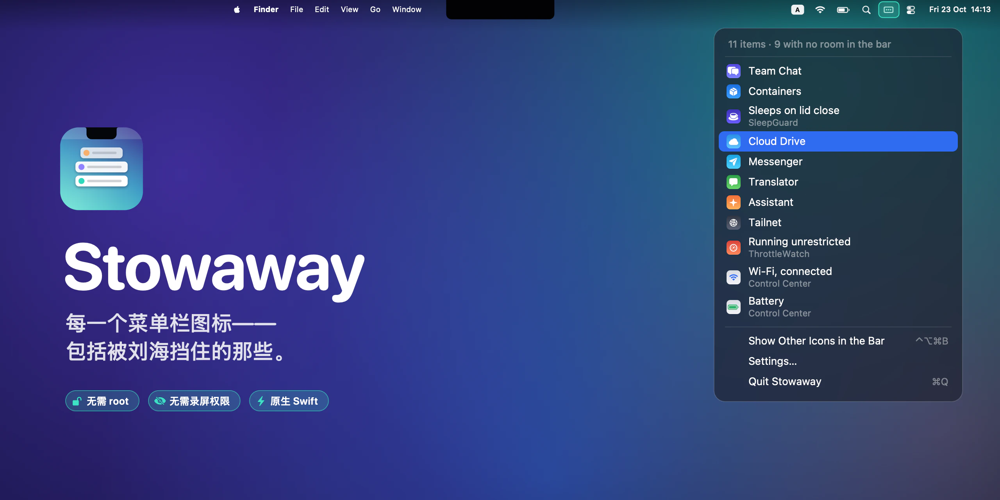
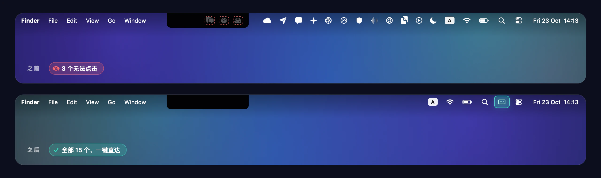
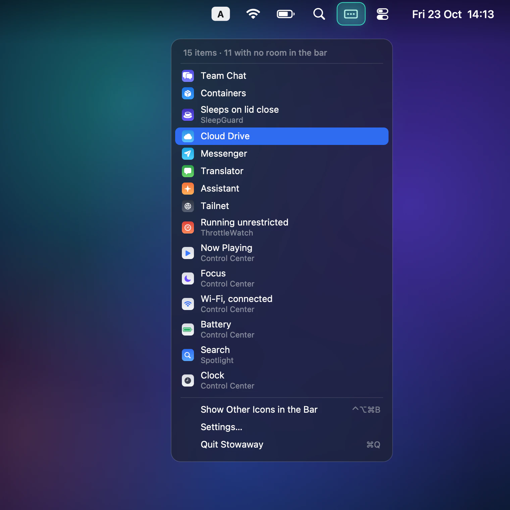
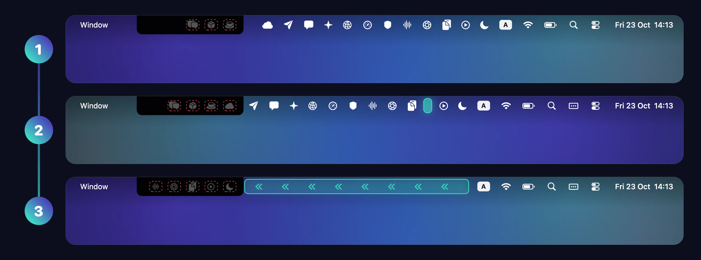
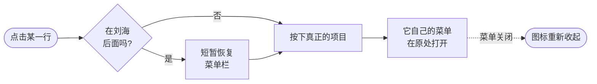

<p align="center">
  
</p>

<h1 align="center">Stowaway</h1>

<p align="center">
  <strong>每一个菜单栏图标——包括被刘海挡住的那些。</strong><br>
  一个小巧的原生 macOS 应用：把杂乱的菜单栏图标收起来，<br>
  再以竖向列表的形式把它们全部交还给你，一键即达。
</p>

<p align="center">
  <a href="https://github.com/an6122003/stowaway/releases/latest"></a>
  
  
  
  
  <a href="LICENSE"></a>
</p>

<p align="center">
  <a href="README.md">English</a> ·
  <a href="README.vi.md">Tiếng Việt</a> ·
  <strong>简体中文</strong>
</p>



## 没人提前告诉你的问题

在带刘海的 MacBook 上，菜单栏正中间立着一堵"墙"。菜单栏应用只要多装一个，macOS 不会缩小图标、不会换行，也不提供任何溢出菜单——它只是不再绘制放不下的图标。这些应用仍在运行，你却再也点不到它们。



Stowaway 分两步解决这个问题：

- **整理菜单栏。** 第三方图标被收到刘海后面，而 Wi‑Fi、电池、聚焦搜索和时钟始终待在原来的位置。
- **全部交还给你。** 点一下——或在任何地方按下 <kbd>⌃</kbd> <kbd>⌥</kbd> <kbd>⌘</kbd> <kbd>B</kbd>——就会展开一个竖向列表，列出菜单栏上的每一个项目，包括被隐藏的。选中一项，它真正的菜单就会打开。

## 功能

| | |
|---|---|
| 🗂 **完整的竖向列表** | 菜单栏上的每一个项目都带有名称和所属应用的图标。顶部会告诉你有多少项在菜单栏里放不下。 |
| 🎯 **打开真正的菜单** | 选中被隐藏的项目时，Stowaway 会短暂恢复菜单栏，让菜单有地方弹出；菜单一关闭就立即重新收起。 |
| 🍏 **系统图标原地不动** | Wi‑Fi、电池、聚焦搜索、输入法和时钟纹丝不动，只收起第三方图标。 |
| ⌨️ **全局快捷键** | <kbd>⌃⌥⌘B</kbd> 在任何应用中都能打开列表，快捷键本身无需任何权限。 |
| 🪶 **只占一个图标的位置** | Stowaway 只在最右侧固定一个图标。就算连它也隐藏，从聚焦搜索再次打开 Stowaway 依然会弹出列表。 |
| 🔒 **没有任何可怕的东西** | 无需 root、无需屏幕录制、没有内核扩展、不联网。纯 Swift 与 AppKit 编写，零第三方依赖。 |

## 列表近看

<p align="center">
  
</p>

项目按照系统给出的描述来命名，所以控制中心的各个模块会分别显示为 *Wi‑Fi*、*电池*、*专注模式* 等，而不是一排一模一样的"控制中心"。被 macOS 关闭的模块——仍然存在但宽度为零——会被过滤掉。

## 工作原理

macOS 没有任何 API 能移动、隐藏或接管其他应用的菜单栏项目。Stowaway 也不需要。它只用 macOS 给每个应用的唯一一根杠杆——**自己那个状态栏项目的宽度**——再加上三次测量。



1. **溢出。** macOS 从右边缘向左依次排列菜单栏项目。空间不够时，最左侧的项目会滑到刘海后面，干脆不被绘制。
2. **固定。** Stowaway 在第三方图标与 Apple 系统图标之间放置一块看不见的隔板。状态栏项目的位置可以通过一个未公开的偏好设置来控制——`NSStatusItem Preferred Position`，*数值越小越靠右*——确切位置则通过测量隔板的落点并不断校正得出。
3. **推送。** 加宽隔板会让它左侧的所有内容等距左移。推得恰到好处时，所有第三方图标都会被推到刘海后面，而位于隔板右侧的 Apple 图标一个像素都不会动。

<details>
<summary><b>最费功夫的那些细节</b></summary>
<br>

- **菜单栏究竟从哪里开始。** 很容易根据最左侧的可见图标来推断可用区域的左边缘——但这是错的：在开发所用的这台 MacBook 上，图标被*报告*在 x = 860，而菜单栏要到 x = 948 才真正可以绘制——这正是那些图标点不到的原因。`NSScreen.auxiliaryTopRightArea` 会直接给出刘海旁边的区域，所以 Stowaway 直接询问系统，而不是去猜。
- **精确推送。** macOS 实际产生的位移总比请求的长度略宽一些，因此推送是自校准的：Stowaway 测量图标的落点，并逐步加宽，直到屏幕上不再留有任何第三方图标。由于 Apple 图标位于隔板右侧，推过头也不会影响到它们——这是一次单向搜索，而不是两头平衡。
- **绝不吞掉点击。** 展开时，隔板的窗口比整个屏幕还宽，会实实在在地压在应用菜单上方。它被设置为忽略鼠标事件，点击会直接穿透到下方。
- **列出与按下。** 列表来自辅助功能 API——并行扫描每个应用的 `AXExtrasMenuBar` 子元素，每个请求的超时为 0.15 秒。已知拥有菜单栏项目的应用会被记住，因此之后的刷新只需访问少数几个进程，而不是全部。
- **重新收起。** 打开一个被隐藏的项目后，Stowaway 会监视它的 `AXSelected` 状态，菜单一关闭就立即重新收起菜单栏。

</details>



## 安装

1. 从 [Releases](https://github.com/an6122003/stowaway/releases/latest) 下载 **Stowaway-1.0.dmg**。
2. 打开后把 **Stowaway** 拖进 **应用程序** 文件夹。
3. 启动它。Stowaway 尚未经过 Apple 公证，所以 macOS 会阻止首次启动：打开 **系统设置 → 隐私与安全性**，点击 **仍要打开**——或者运行：
   ```bash
   xattr -dr com.apple.quarantine /Applications/Stowaway.app
   ```
4. 点击 Stowaway 的图标，选择 **Allow Stowaway to list your menu bar items…**，然后在 **隐私与安全性 → 辅助功能** 中启用 Stowaway。

> **系统要求：** macOS 13 Ventura 或更高版本。通用二进制，同时支持 Apple 芯片和 Intel。专为带刘海的 MacBook 设计，在任何 Mac 上都能使用。

## 使用

| 想要… | 这样做 |
|---|---|
| 查看菜单栏上的所有项目 | 点击 Stowaway 图标，或按 <kbd>⌃⌥⌘B</kbd> |
| 打开图标被隐藏的应用 | 在列表中选中它 |
| 让所有图标回到菜单栏 | 列表底部的 **Show Other Icons in the Bar** |
| 修改它的行为 | 右键点击 Stowaway 图标 → **Settings** |
| 隐藏 Stowaway 图标后再打开它 | 从聚焦搜索再次打开 Stowaway |

**设置** *（应用界面为英文）*

- **Keep Wi‑Fi, Battery and Clock Visible**——默认开启。关闭后会把*所有*图标都收起来。
- **Hide Other Icons**——完全关闭整理功能，只把 Stowaway 当作列表来用。
- **Show Stowaway's Own Icon**——完全用键盘操作。
- **Open at Login**——登录时自动打开。

## 隐私

Stowaway 只申请一项权限：**辅助功能**，并且只用于两件事：读取菜单栏项目——名称、所属应用和位置——以及按下你选择的那一项。它不读取窗口、按键或屏幕内容；全局快捷键使用 Carbon 的 `RegisterEventHotKey`，根本不需要任何权限。应用里没有任何联网代码。

## 常见问题

<details>
<summary><b>Stowaway 已在辅助功能中勾选，列表却仍然要求授权。</b></summary>
<br>

macOS 会把授权绑定到应用的具体构建版本。更新到签名不同的版本后，旧的勾选指向的是一个已经不存在的应用——而因为列表里已有这一条目，macOS 不会再次询问。清除它，然后重新授权一次：

```bash
tccutil reset Accessibility io.github.an6122003.stowaway
```
</details>

<details>
<summary><b>刘海和我的图标之间空出了一块。</b></summary>
<br>

这是菜单栏一如既往从右向左排列的结果——图标更少的菜单栏本来就长这样。Stowaway 把空白留在被隐藏图标原来的位置，而不是在系统图标中间开一个洞。
</details>

<details>
<summary><b>"正在播放"和"专注模式"也被收起来了。</b></summary>
<br>

菜单栏重新排列时，控制中心会自行把这些临时模块挪到左侧，于是它们会和第三方图标一起被收起。它们在列表中依然一键可达。Wi‑Fi、电池、聚焦搜索、输入法和时钟则始终保留。
</details>

<details>
<summary><b>我刚装了一个新的菜单栏应用，它还显示着。</b></summary>
<br>

Stowaway 会在所有图标都显示时测量菜单栏。选择一次 **Show Other Icons in the Bar**，稍等片刻让它重新测量，然后再隐藏。
</details>

<details>
<summary><b>它和 Bartender 或 Ice 有什么不同？</b></summary>
<br>

Bartender、Ice 这类应用可以借助屏幕录制权限截取菜单栏，并在自己的窗口中重绘，因此能做更多事——重新排序、第二条菜单栏——代价是权限更重、可能出问题的环节更多。Stowaway 只改变自己状态栏项目的宽度，并读取辅助功能本就提供的信息。能力更少，但能坏的地方也少得多。
</details>

## 从源码构建

```bash
git clone https://github.com/an6122003/stowaway.git
cd stowaway
./build.sh          # → build/Stowaway.app   （当前机器的架构）
./package.sh        # → dist/Stowaway-1.0.dmg （通用二进制）
```

不需要 Xcode 工程，也没有任何依赖——只要装有 Xcode 命令行工具即可。

> **经常重新构建？** ad-hoc 签名每次构建都会变化，这会悄无声息地让辅助功能授权失效。如果你有 Apple Development 证书，`build.sh` 会自动用它签名；否则可以用 `./scripts/make-signing-identity.sh` 一次性创建一个固定的本地签名身份。发布版本使用 `STOWAWAY_SIGN=adhoc ./package.sh`，确保二进制中不会包含任何证书信息。

开发时的小工具：

```bash
./scripts/make-readme-art.sh     # 重新生成本 README 中的所有图片
defaults write io.github.an6122003.stowaway DebugDiagnostics -bool true
                                 # 把测得的菜单栏布局写入 $TMPDIR/stowaway-layout.txt
```

| 路径 | |
|---|---|
| `Sources/AppDelegate.swift` | 状态栏项目、宽度杠杆、校准、菜单 |
| `Sources/MenuBarItems.swift` | 辅助功能：列出并按下其他应用的项目 |
| `Sources/GlobalHotKey.swift` | 无需权限的全局快捷键 |
| `scripts/make-icon.swift` | 应用图标，完全用代码绘制 |
| `scripts/make-readme-art.swift` | 本 README 中的所有图片，完全用代码绘制 |

## 致谢

扩展隔板的技巧源自 [Dozer](https://github.com/Mortennn/Dozer) 和 Dwarves Foundation 的 [Hidden Bar](https://github.com/dwarvesf/hidden)。Stowaway 在此基础上加入了竖向列表、能感知刘海并让 Apple 系统图标保持原位的精确推送，以及菜单关闭后立即重新收起。

## 港湾

Stowaway 是三款小巧原生 Mac 工具之一，它们风格一致，也都只把一件事做好：

| | | |
|---|---|---|
|  | **Stowaway** | 每一个菜单栏图标——包括被刘海挡住的那些 |
|  | **[Marina](https://github.com/an6122003/marina)** | 每块屏幕，都有程序坞 |
|  | **[Anchorlight](https://github.com/an6122003/anchorlight)** | 合上盖子，灯依然亮着 |

## 许可证

[MIT](LICENSE) © 2026 an6122003
